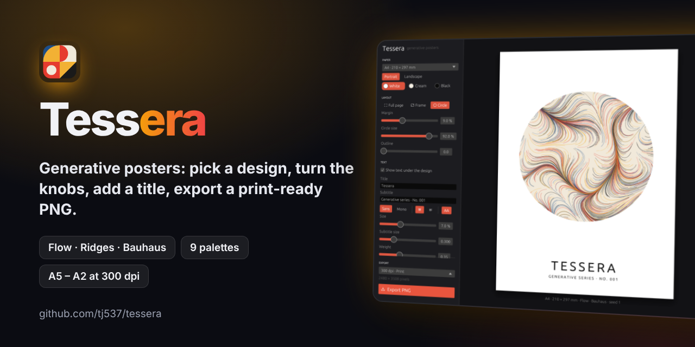

**Hi, I'm Tom 👋**

I build small apps that I want to use myself – and learn programming with AI along the way.

**💡 What I care about**

- 🧰 **Useful everyday apps** – small, fast and modern. Written in HTML or Rust.
- 🎨 **Good design and UX** – I love designing unconventional, intuitive, and functional user experiences. I place a strong emphasis on user personalization and strong visual aesthetics.
- 🔒 **Privacy and open source** – your files stay on your computer, all code stays open.

**✅ Ready to use**

<table>
<tr>
<td width="50%" valign="top">

**🪐 Solarum** · ✅ *ready to use*

Techno from another planet: a drum machine for people who have never used one. Every sound is an orbit round the sun, every beat a planet, bass and acid included. Solari, the little robot on board, rolls fresh grooves or plays a whole set with breakdowns and drops. Written in Rust.

[▶️ Website](https://tj537.github.io/solarum/) · [⬇️ macOS](https://github.com/tj537/solarum/releases/latest/download/Solarum-macos-universal.zip) · [⬇️ Windows](https://github.com/tj537/solarum/releases/latest/download/Solarum-windows-x64.zip) · [📂 Code](https://github.com/tj537/solarum)

</td>
<td width="50%" valign="top">

**🧠 Mindful** · ✅ *ready to use*

Mind maps, Markdown and presentations in one small app for Mac and Windows. Write an outline once and present it as slides with diagrams and charts, presenter view and phone remote. Written in Rust.

[⬇️ macOS](https://github.com/tj537/mindful/releases/latest/download/Mindful-macos-arm64.zip) · [⬇️ Windows](https://github.com/tj537/mindful/releases/latest/download/Mindful-windows-x64.zip) · [📂 Code](https://github.com/tj537/mindful)

</td>
</tr>
<tr>
<td width="50%" valign="top">

**🧰 Toms Tools** · ✅ *ready to use*

32 small tools in one HTML file: PDFs, images, screenshots, mind maps, SWOT, citations, flashcards and more. Runs offline in the browser, nothing to install.

[▶️ Try it](https://tj537.github.io/toms-tools/) · [⬇️ Download](https://github.com/tj537/toms-tools/releases/latest/download/toms-tools.html) · [📂 Code](https://github.com/tj537/toms-tools)

</td>
<td width="50%" valign="top">

**🔮 NotSure** · ✅ *ready to use*

Can't decide? Let chance do it: a lottery ball machine, a 3D coin flip and an oracle that looks like an AI chat but only asks fate. Runs in the browser.

[▶️ Try it](https://tj537.github.io/notsure/) · [📂 Code](https://github.com/tj537/notsure)

</td>
</tr>
</table>

**🚧 Under development**

<table>
<tr>
<td width="50%" valign="top">

**🎨 Tessera** · 🚧 *under development*

Generative posters: pick a design (flow lines, mountain ridges or Bauhaus tiles), turn the knobs, add a title and export a print-ready PNG up to A2. Written in Rust.

[🏷️ v0.1.0](https://github.com/tj537/tessera/releases/tag/v0.1.0) · [📂 Code](https://github.com/tj537/tessera)

</td>
<td width="50%" valign="top">

**🎞️ Filmriss** · 🚧 *under development*

A camera app with live film looks: 15 simulations inspired by classic film stocks, applied live on the GPU, with film grain, your own recipes and `.cube` LUTs. Early development version, tested on Mac so far – no downloads yet, you build it from source. Written in Rust.

[🏷️ v0.1.0 (pre-release)](https://github.com/tj537/Filmriss36/releases/tag/v0.1.0) · [📂 Code](https://github.com/tj537/Filmriss36)

</td>
</tr>
</table>

Ideas or bugs? Open an issue in [Solarum](https://github.com/tj537/solarum/issues), [Mindful](https://github.com/tj537/mindful/issues), [Toms Tools](https://github.com/tj537/toms-tools/issues/new/choose), [NotSure](https://github.com/tj537/notsure/issues), [Tessera](https://github.com/tj537/tessera/issues) or [Filmriss](https://github.com/tj537/Filmriss36/issues).
